# MediSense AI — Méthodologie de Travail
**Rapport PFE 2025-2026 | Abderrahim Boussyf | EMSI Marrakech | n.synergy**

---

## Table des Matières

1. [Choix de la Méthode Agile](#1-choix-de-la-méthode-agile)
2. [Framework Scrum](#2-framework-scrum)
   - 2.1 Rôles
   - 2.2 Artefacts
   - 2.3 Cérémonies
   - 2.4 Cycle Scrum
3. [Product Backlog — Toutes les User Stories](#3-product-backlog--toutes-les-user-stories)
   - 3.1 Matrice MoSCoW
   - 3.2 Backlog complet par Sprint
4. [Planning des Sprints](#4-planning-des-sprints)
5. [Diagramme de Gantt](#5-diagramme-de-gantt)
6. [Vélocité & Story Points](#6-vélocité--story-points)
7. [Burndown Chart Global](#7-burndown-chart-global)
8. [Définition of Done (DoD)](#8-définition-of-done-dod)
9. [Gestion des Risques](#9-gestion-des-risques)
10. [Environnement & Outils de Travail](#10-environnement--outils-de-travail)
11. [Processus Git & CI/CD](#11-processus-git--cicd)
12. [Plan d'Implémentation — Objectif 10/10](#12-plan-dimplémentation--objectif-1010)

---

## 1. Choix de la Méthode Agile

### Pourquoi Agile plutôt que Cycle en V ?

Le projet MediSense AI combine **8 domaines techniques distincts** (IoT, LLM, ML, RGPD, DevOps, MLOps, CRM, Deep Learning) avec des exigences qui évoluent à mesure que les composants s'intègrent. Le cycle en V impose de geler les spécifications dès le début — incompatible avec un projet IA où les performances des modèles (F1, AUC-ROC) ne sont connues qu'après expérimentation.

| Critère | Cycle en V | Agile Scrum |
|---------|-----------|-------------|
| Spécifications figées | Requis | Non requis |
| Livraisons intermédiaires | Non | Oui (chaque sprint) |
| Adaptation aux résultats ML | Impossible | Naturelle |
| Feedback continu encadrant | Non | Oui (Sprint Review) |
| Gestion des risques techniques | Tardive | Continue |
| Convient aux projets IA | Non | **Oui** |

### Scrum vs Kanban vs SAFe

**Scrum** a été retenu car :
- Sprints de **2 semaines** correspondent à la granularité des livrables (1 pipeline = 1 sprint)
- Les **Sprint Reviews** permettent la validation de l'encadrant à chaque étape
- Le **Product Backlog** priorisé garantit que les fonctionnalités critiques (auth, RGPD) sont livrées en premier
- Adapté à un projet solo avec supervision externe (encadrant n.synergy)

---

## 2. Framework Scrum

### 2.1 Rôles

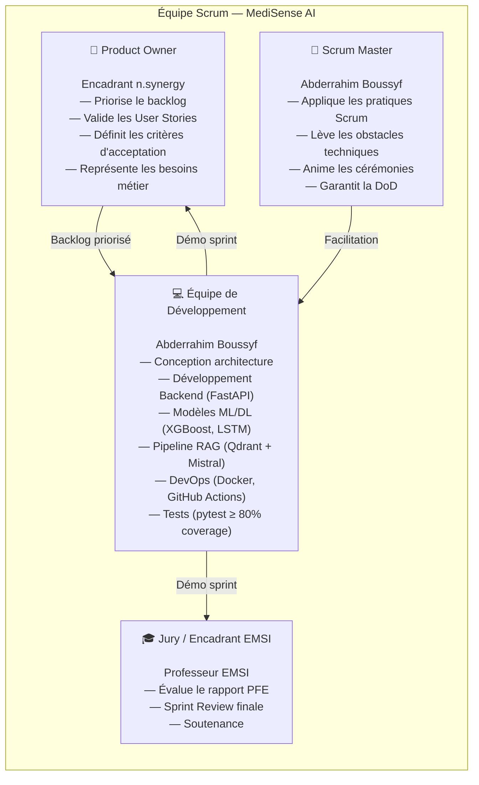

---

### 2.2 Artefacts

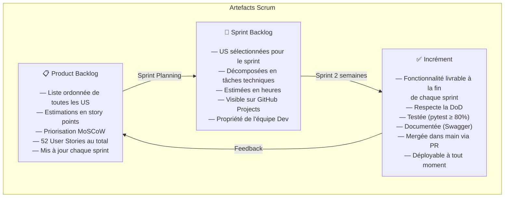

---

### 2.3 Cérémonies

| Cérémonie | Durée | Fréquence | Participants | Livrable |
|-----------|-------|-----------|--------------|----------|
| **Sprint Planning** | 2h | Début de sprint | PO + Dev | Sprint Backlog validé |
| **Daily Standup** | 15min | Chaque jour | Dev (+ SM) | Rapport d'avancement |
| **Sprint Review** | 1h | Fin de sprint | PO + Dev + Jury | Démo du produit fonctionnel |
| **Sprint Retrospective** | 30min | Fin de sprint | Dev + SM | Plan d'amélioration |
| **Backlog Refinement** | 1h | Mi-sprint | PO + Dev | Backlog affiné et estimé |

---

### 2.4 Cycle Scrum

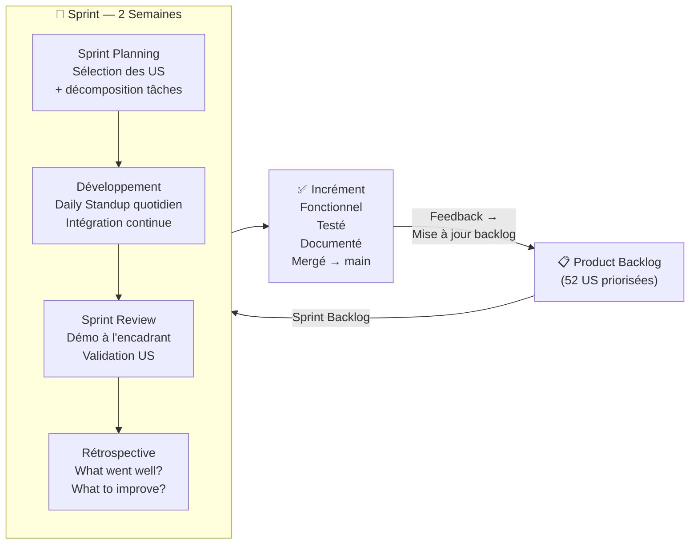

---

## 3. Product Backlog — Toutes les User Stories

### 3.1 Matrice MoSCoW

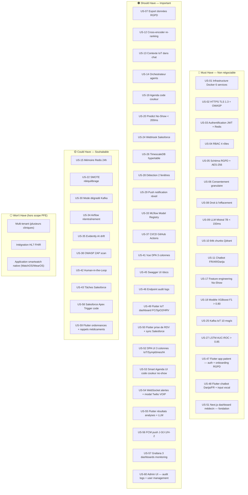

---

### 3.2 Backlog Complet par Sprint

#### Sprint 1 — Fondation & Authentification `30 Mar – 12 Avr 2026` `✅ TERMINÉ`

| ID | User Story | Story Points | Priorité | Statut |
|----|-----------|:---:|:---:|:---:|
| US-01 | `docker compose up` lance 6 services. `/health` répond 200 en < 2s | 5 | Must | ✅ Done |
| US-02 | HTTPS sur tous les endpoints. TLS 1.3 via nginx. Headers OWASP | 5 | Must | ✅ Done |
| US-03 | OAuth2/JWT : access token (15min) + refresh (7j) + révocation Redis | 8 | Must | ✅ Done |
| US-04 | RBAC : 4 rôles (patient, doctor, secretary, admin). Non autorisé → 403 | 5 | Must | ✅ Done |
| US-05 | Schéma RGPD : patients UUID pseudonymisés + identité AES-256 | 8 | Must | ✅ Done |
| US-45 | Swagger auto-docs à `/api/v1/docs` (assets locaux, no CDN) | 3 | Should | ✅ Done |
| **Total** | | **34 pts** | | |

#### Sprint 2 — RGPD & Consentement `01 Avr – 14 Avr 2026` `✅ TERMINÉ`

| ID | User Story | Story Points | Priorité | Statut |
|----|-----------|:---:|:---:|:---:|
| US-06 | Consentement granulaire : 3 opt-ins séparés (IoT / NLP / Partage) | 5 | Must | ⏳ |
| US-07 | Export données patient : `GET /patient/data/export` JSON complet (Art.15) | 5 | Should | ⏳ |
| US-08 | Droit à l'effacement : `DELETE /patient/{uuid}` + cascade Qdrant (Art.17) | 8 | Must | ⏳ |
| US-46 | Endpoint audit logs paginé : `GET /admin/audit-logs` (Art.30) | 3 | Should | ⏳ |
| **Total** | | **21 pts** | | |

#### Sprint 3 — RAG Pipeline & LLM `15 Avr – 28 Avr 2026` `✅ TERMINÉ`

| ID | User Story | Story Points | Priorité | Statut |
|----|-----------|:---:|:---:|:---:|
| US-09 | Mistral 7B via Ollama. Latence retrieval P95 = 265 ms (CPU) | 8 | Must | ✅ Done |
| US-10 | Indexer 96 303 pts Qdrant (ICD-10, BDPM France, medicament.ma, corpus offline) | 13 | Must | ✅ Done |
| US-11 | Chatbot symptômes FR/AR/Darija avec triage cognitif + 141 SAMU Maroc | 8 | Must | ✅ Done |
| US-12 | Hybrid Dense+BM25+RRF, safety layer code-level, red-team 10 cas | 5 | Should | ✅ Done |
| **Total** | | **34 pts** | | |

#### Sprint 4 — Agents IA & DPA `11 Mai – 24 Mai 2026` `⏳ À venir`

| ID | User Story | Story Points | Priorité | Statut |
|----|-----------|:---:|:---:|:---:|
| US-13 | Contexte IoT injecté dans le chat patient (anomalies → RAG) | 8 | Should | ⏳ |
| US-14 | Orchestrateur multi-agents (triage → RDV → CRM) | 13 | Should | ⏳ |
| US-15 | Mémoire de conversation Redis TTL 24h (multi-session) | 3 | Could | ⏳ |
| US-41 | Vue DPA médecin : résumé 3 colonnes (Symptômes / IoT / Actions) | 8 | Should | ⏳ |
| US-42 | Human-in-the-Loop : médecin valide/modifie le résumé IA | 5 | Could | ⏳ |
| **Total** | | **37 pts** | | |

#### Sprint 5 — ML Prédictif No-Show `25 Mai – 07 Jun 2026` `⏳ À venir`

| ID | User Story | Story Points | Priorité | Statut |
|----|-----------|:---:|:---:|:---:|
| US-17 | Feature engineering : 8 features patient (distance, météo, historique...) | 5 | Must | ⏳ |
| US-18 | Entraîner XGBoost vs LightGBM vs CatBoost. F1 cible > 0.80 | 13 | Must | ⏳ |
| US-19 | Agenda code couleur : 🔴 > 70% / 🟠 40-70% / 🟢 < 40% | 5 | Should | ⏳ |
| US-20 | Endpoint `POST /predict/noshow` réponse < 200ms | 3 | Should | ⏳ |
| US-22 | SMOTE sur données déséquilibrées (no-show < 20% des RDV) | 5 | Could | ⏳ |
| **Total** | | **31 pts** | | |

#### Sprint 6 — Salesforce & MLOps `08 Jun – 21 Jun 2026` `⏳ À venir`

| ID | User Story | Story Points | Priorité | Statut |
|----|-----------|:---:|:---:|:---:|
| US-24 | Webhook Salesforce Apex : tâche secrétaire créée automatiquement | 8 | Should | ⏳ |
| US-33 | MLflow Model Registry : versioning + métriques + artefacts SHAP | 5 | Should | ⏳ |
| US-37 | GitHub Actions CI/CD : build → test → push image → deploy | 8 | Should | ⏳ |
| US-38 | OWASP ZAP scan automatisé (rapport vulnérabilités) | 5 | Could | ⏳ |
| US-43 | Interface secrétaire : gestion tâches Salesforce (confirmer, clôturer) | 3 | Could | ⏳ |
| **Total** | | **29 pts** | | |

#### Sprint 7 — IoT Pipeline & LSTM `22 Jun – 05 Juil 2026` `⏳ À venir`

| ID | User Story | Story Points | Priorité | Statut |
|----|-----------|:---:|:---:|:---:|
| US-25 | Ingestion Kafka biométriques : 10 msg/s en débit continu | 8 | Must | ⏳ |
| US-26 | TimescaleDB hypertable : partitionnement par jour, compression auto | 5 | Should | ⏳ |
| US-27 | LSTM Bidirectionnel PyTorch : AUC-ROC > 0.85 sur données synthétiques | 13 | Must | ⏳ |
| US-28 | Détection sur 2 fenêtres glissantes : 5min (critique) + 60min (tendance) | 8 | Should | ⏳ |
| US-29 | Push notification au réveil (détection accéléromètre) | 5 | Should | ⏳ |
| **Total** | | **39 pts** | | |

#### Sprint 8 — Intégration & Production `06 Juil – 19 Juil 2026` `⏳ À venir`

| ID | User Story | Story Points | Priorité | Statut |
|----|-----------|:---:|:---:|:---:|
| US-30 | Mode dégradé Kafka : buffer local + reprise automatique à reconnexion | 8 | Could | ⏳ |
| US-34 | DAG Airflow : réentraînement hebdomadaire automatique | 8 | Could | ⏳ |
| US-35 | Evidently AI : détection dérive données (PSI + feature importance shift) | 5 | Could | ⏳ |
| US-36 | Auto-rollback : si F1 chute > 10% en prod → restauration version N-1 | 5 | Could | ⏳ |
| **Total** | | **26 pts** | | |

#### Sprint 9 — Application Mobile Patient (Flutter) `20 Juil – 02 Aoû 2026` `⏳ À venir`

| ID | User Story | Story Points | Priorité | Statut |
|----|-----------|:---:|:---:|:---:|
| US-47 | Flutter — Onboarding 3 slides + auth JWT + consentement RGPD UI (opt-in IoT/NLP/Partage) | 5 | Must | ⏳ |
| US-48 | Flutter — Chatbot triage Darija/FR/AR avec input vocal (STT) + contexte IoT pré-chargé | 8 | Must | ⏳ |
| US-49 | Flutter — Dashboard IoT personnel : courbes FC/SpO2/HRV sur 7/30/90 jours (charts animés) | 8 | Should | ⏳ |
| US-50 | Flutter — Prise de RDV en ligne avec calendrier temps réel + sync Salesforce | 5 | Should | ⏳ |
| US-55 | Flutter — Résultats d'analyses avec interprétation LLM simplifiée (Mistral 7B) | 5 | Should | ⏳ |
| US-56 | FCM push notifications : rappels automatiques J-3, J-1, H-2 (Firebase Cloud Messaging) | 5 | Should | ⏳ |
| US-59 | Flutter — Ordonnances numériques + rappels médicaments (heure + dosage) | 3 | Could | ⏳ |
| **Total** | | **39 pts** | | |

#### Sprint 10 — Dashboard Médecin (Next.js) + Monitoring (Grafana) `03 Aoû – 16 Aoû 2026` `⏳ À venir`

| ID | User Story | Story Points | Priorité | Statut |
|----|-----------|:---:|:---:|:---:|
| US-51 | Next.js — Fondation dashboard médecin : auth, routing, layout sidebar, AuthGuard RBAC | 5 | Must | ⏳ |
| US-52 | DPA UI — Vue 3 colonnes : IoT anomaly graphs \| NLP symptoms verbatim \| RAG suggestions IA | 8 | Should | ⏳ |
| US-53 | Smart Agenda UI — code couleur no-show 🟢 <20% / 🟠 20–40% / 🔴 >40% + créneaux remplacement | 5 | Should | ⏳ |
| US-54 | WebSocket alertes IoT temps réel + modal popup + bouton "Appeler patient" (Twilio VOIP) | 8 | Should | ⏳ |
| US-57 | Grafana — 3 dashboards provisionnés : System Health / ML Performance / Business KPIs | 5 | Should | ⏳ |
| US-60 | Admin UI — audit logs viewer paginé + filtres + user management (Next.js pages admin) | 5 | Should | ⏳ |
| US-58 | Salesforce Apex Trigger code (côté CRM) + payload types partagés | 3 | Could | ⏳ |
| **Total** | | **39 pts** | | |

---

## 4. Planning des Sprints

```mermaid
flowchart TB
    subgraph PLAN["Planning Global — 10 Sprints / 5 Mois"]
        direction LR

        subgraph S1["Sprint 1<br/>30 Mar – 12 Avr<br/>✅ TERMINÉ"]
            T1["Infrastructure Docker<br/>Auth JWT + RBAC<br/>Schéma RGPD<br/>Swagger UI<br/>34 pts"]
        end

        subgraph S2["Sprint 2<br/>13 Avr – 26 Avr<br/>⏳ En cours"]
            T2["Consentement granulaire<br/>Export RGPD<br/>Droit à l'effacement<br/>Audit logs endpoint<br/>21 pts"]
        end

        subgraph S3["Sprint 3<br/>27 Avr – 10 Mai<br/>⏳ À venir"]
            T3["Mistral 7B Ollama<br/>84k chunks Qdrant<br/>Chatbot FR/AR/Darija<br/>Cross-encoder<br/>34 pts"]
        end

        subgraph S4["Sprint 4<br/>11 Mai – 24 Mai<br/>⏳ À venir"]
            T4["Contexte IoT chat<br/>Orchestrat. agents<br/>Mémoire Redis<br/>DPA 3 colonnes<br/>Human-in-Loop<br/>37 pts"]
        end

        subgraph S5["Sprint 5<br/>25 Mai – 07 Jun<br/>⏳ À venir"]
            T5["Feature engineering<br/>XGBoost vs LGB<br/>Agenda couleur<br/>Predict endpoint<br/>SMOTE<br/>31 pts"]
        end

        subgraph S6["Sprint 6<br/>08 Jun – 21 Jun<br/>⏳ À venir"]
            T6["Salesforce webhook<br/>MLflow Registry<br/>CI/CD Actions<br/>OWASP ZAP<br/>29 pts"]
        end

        subgraph S7["Sprint 7<br/>22 Jun – 05 Juil<br/>⏳ À venir"]
            T7["Kafka ingestion<br/>TimescaleDB<br/>LSTM AUC > 0.85<br/>2 fenêtres détect.<br/>Push notif.<br/>39 pts"]
        end

        subgraph S8["Sprint 8<br/>06 Juil – 19 Juil<br/>⏳ À venir"]
            T8["Mode dégradé Kafka<br/>Airflow DAG<br/>Evidently drift<br/>Auto-rollback<br/>26 pts"]
        end

        subgraph S9["Sprint 9<br/>20 Juil – 02 Aoû<br/>⏳ À venir"]
            T9["Flutter app patient<br/>Onboarding + Auth<br/>Chatbot vocal<br/>IoT dashboard<br/>FCM push notif.<br/>39 pts"]
        end

        subgraph S10["Sprint 10<br/>03 Aoû – 16 Aoû<br/>⏳ À venir"]
            T10["Next.js dashboard<br/>DPA 3 colonnes UI<br/>Smart Agenda UI<br/>WebSocket + Twilio<br/>Grafana dashboards<br/>39 pts"]
        end

        subgraph FIN["Finalisation<br/>17 Aoû – 31 Aoû"]
            T11["Rédaction rapport<br/>Préparation soutenance<br/>Tests intégration<br/>Démonstration"]
        end

        S1 --> S2 --> S3 --> S4 --> S5 --> S6 --> S7 --> S8 --> S9 --> S10 --> FIN
    end
```

---

## 5. Diagramme de Gantt

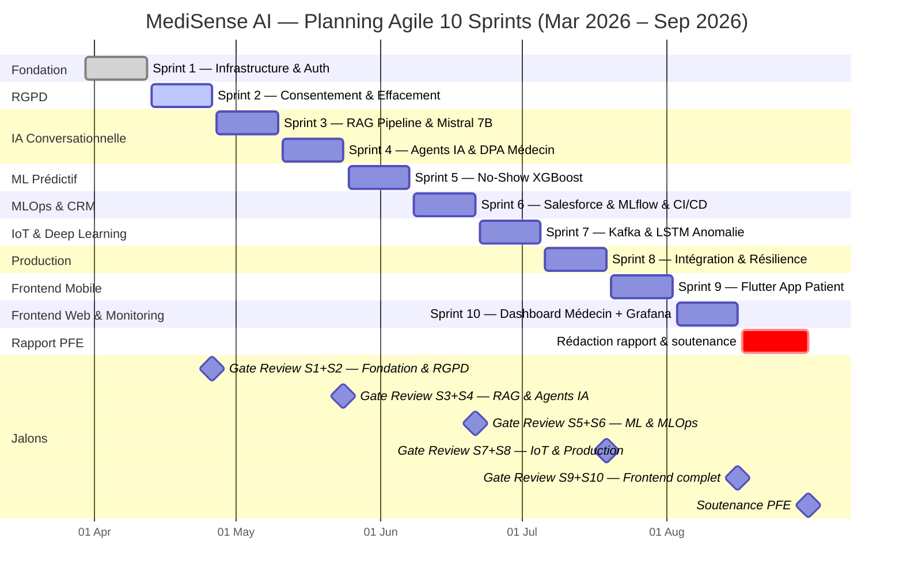

---

## 6. Vélocité & Story Points

### Résumé par Sprint

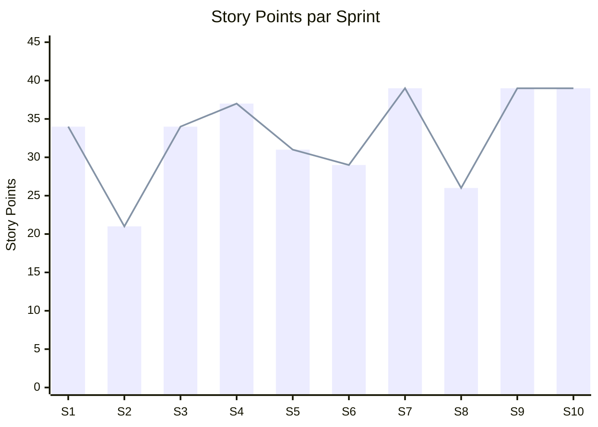

### Tableau Récapitulatif

| Sprint | Durée | User Stories | Story Points | Complexité dominante |
|--------|-------|:---:|:---:|---|
| Sprint 1 | 2 sem. | 6 US | 34 pts | Infrastructure / Sécurité |
| Sprint 2 | 2 sem. | 4 US | 21 pts | Conformité RGPD |
| Sprint 3 | 2 sem. | 4 US | 34 pts | RAG / Indexation / LLM |
| Sprint 4 | 2 sem. | 5 US | 37 pts | Agents IA / Orchestration |
| Sprint 5 | 2 sem. | 5 US | 31 pts | ML / Feature Engineering |
| Sprint 6 | 2 sem. | 5 US | 29 pts | MLOps / CRM / DevOps |
| Sprint 7 | 2 sem. | 5 US | 39 pts | IoT / Deep Learning |
| Sprint 8 | 2 sem. | 4 US | 26 pts | Résilience / Production |
| Sprint 9 | 2 sem. | 7 US | 39 pts | Flutter Mobile / FCM / IoT UI |
| Sprint 10 | 2 sem. | 7 US | 39 pts | Next.js Dashboard / Grafana / Twilio |
| **TOTAL** | **20 sem.** | **52 US** | **329 pts** | |

> **Vélocité moyenne :** 32.9 story points / sprint
> **Estimation :** Fibonacci modifiée — 1, 2, 3, 5, 8, 13 points

---

## 7. Burndown Chart Global

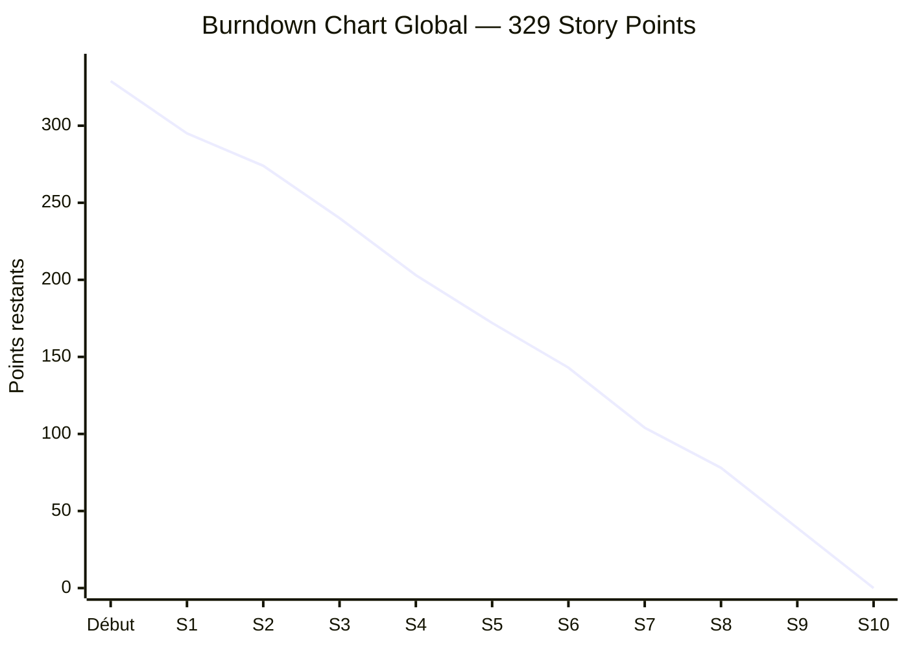

> **Ligne idéale :** décroissance linéaire de 329 → 0 sur 10 sprints.
> **Lecture :** après Sprint 1 (34 pts livrés), il reste 295 pts. Sprints 9 & 10 couvrent le frontend complet (Flutter + Next.js + Grafana — 78 pts). La courbe doit rester proche de la ligne idéale pour garantir la livraison avant soutenance.

---

## 8. Définition of Done (DoD)

La DoD est le contrat de qualité entre le Product Owner et l'équipe. **Une User Story n'est "Done" que si tous les critères sont satisfaits.**

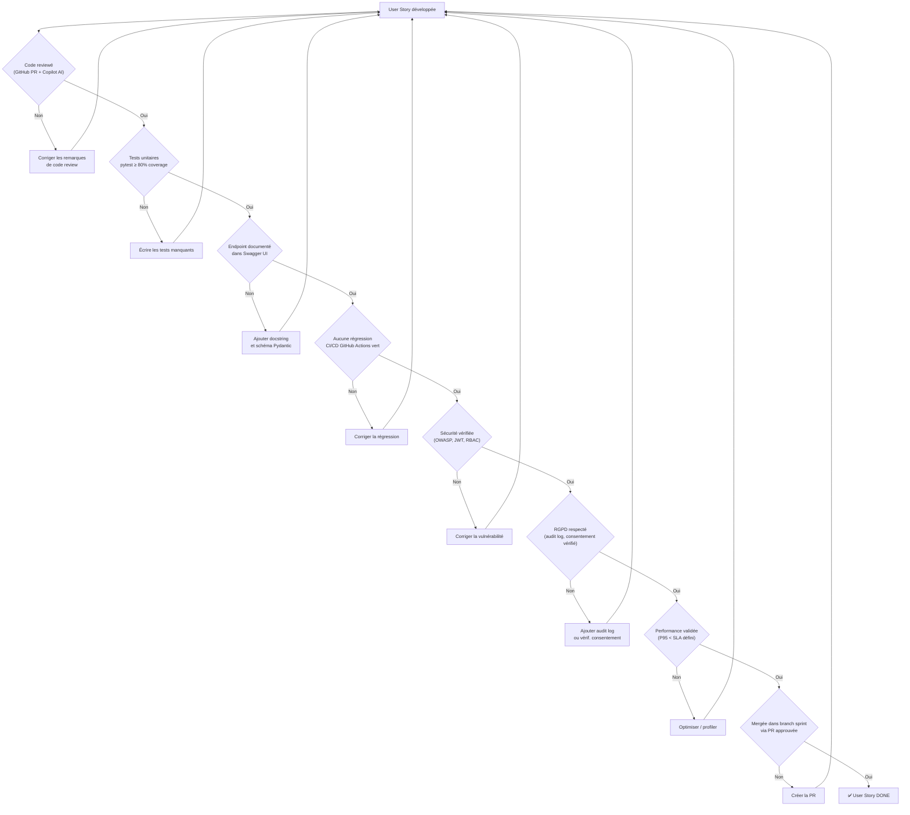

### Critères DoD par Catégorie

| Catégorie | Critère | Mesure |
|-----------|---------|--------|
| **Code** | Revue par Copilot AI + auto-review | PR approuvée |
| **Tests** | Couverture pytest | ≥ 80% (rapport `--cov`) |
| **API** | Documentation Swagger | Schémas Pydantic complets |
| **CI/CD** | Pipeline GitHub Actions | Tous checks verts |
| **Sécurité** | Pas de secret en dur, RBAC validé | OWASP check |
| **RGPD** | Audit log inséré, consentement vérifié | Log visible `/admin/audit-logs` |
| **Performance** | Latence P95 | Auth < 500ms, RAG < 150ms, ML < 200ms |
| **Git** | Branche sprint, PR vers main | Branch `sprint/N-*` mergée |

---

## 9. Gestion des Risques

### 9.1 Registre des Risques

| ID | Catégorie | Risque | Probabilité (P) | Impact (I) | Score P×I | Criticité |
|----|-----------|--------|:---:|:---:|:---:|:---:|
| R-01 | Technique IA | Latence Mistral 7B > 150ms en local | 4 | 4 | **16** | 🔴 Critique |
| R-02 | Technique ML | F1-Score XGBoost < 0.80 (no-show) | 3 | 5 | **15** | 🔴 Critique |
| R-03 | Données | Données patients insuffisantes / non réalistes | 4 | 5 | **20** | 🔴 Critique |
| R-04 | Technique DL | AUC-ROC LSTM < 0.85 (anomalie IoT) | 3 | 4 | **12** | 🟠 Élevé |
| R-05 | Conformité | Fuite de données personnelles (RGPD) | 1 | 5 | **5** | 🟠 Élevé |
| R-06 | MLOps | Dérive du modèle en production | 4 | 3 | **12** | 🟠 Élevé |
| R-07 | Infrastructure | RAM insuffisante pour Ollama + Stack Docker | 3 | 3 | **9** | 🟡 Modéré |
| R-08 | Infrastructure | Indisponibilité Kafka (streaming IoT) | 2 | 3 | **6** | 🟡 Modéré |
| R-09 | Intégration | Webhook Salesforce rejeté (auth, quota) | 2 | 2 | **4** | 🟢 Faible |
| R-10 | Sécurité | Vulnérabilité OWASP non détectée | 2 | 4 | **8** | 🟡 Modéré |
| R-11 | Planning | Retard d'un sprint (sous-estimation) | 3 | 3 | **9** | 🟡 Modéré |
| R-12 | Technique | Incompatibilité version librairie ML | 2 | 2 | **4** | 🟢 Faible |

> **Échelle :** Probabilité et Impact de 1 (très faible) à 5 (très élevé). Score = P × I. Seuils : ≥ 12 🔴 Critique, 6–11 🟠/🟡 Modéré–Élevé, ≤ 5 🟢 Faible.

---

### 9.2 Matrice Probabilité × Impact

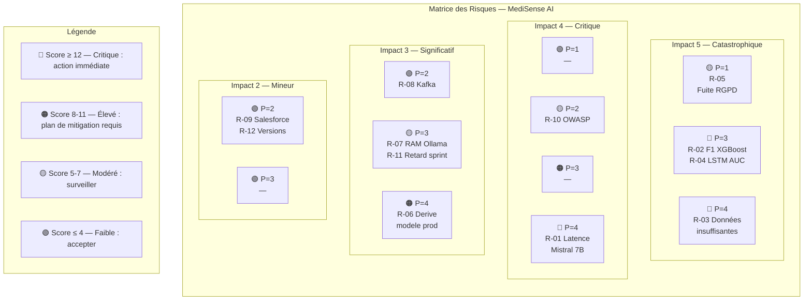

---

### 9.3 Plan de Mitigation Détaillé

#### R-01 — Latence Mistral 7B > 150ms `🔴 Critique`

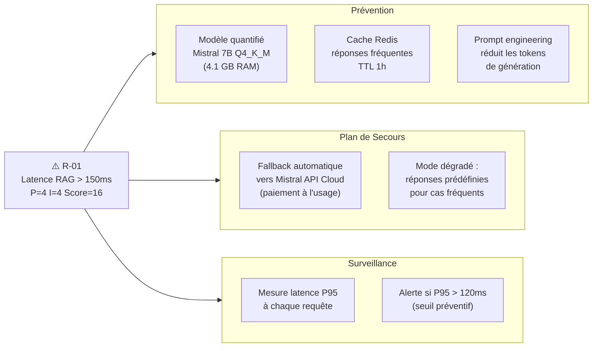

---

#### R-02 — F1-Score XGBoost < 0.80 `🔴 Critique`

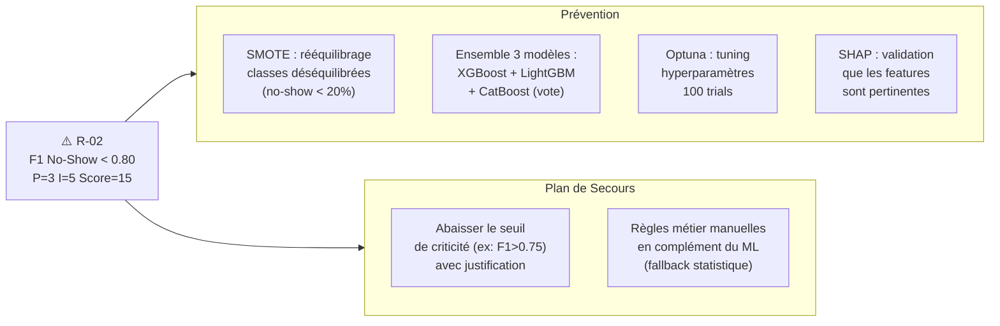

---

#### R-03 — Données Patients Insuffisantes `🔴 Critique (Score=20)`

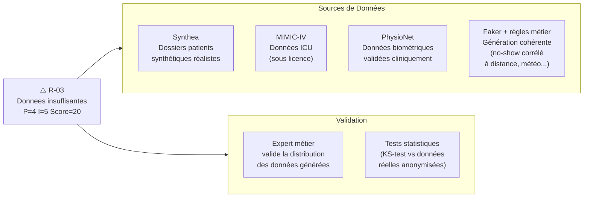

---

#### R-04 — AUC-ROC LSTM < 0.85 `🟠 Élevé`

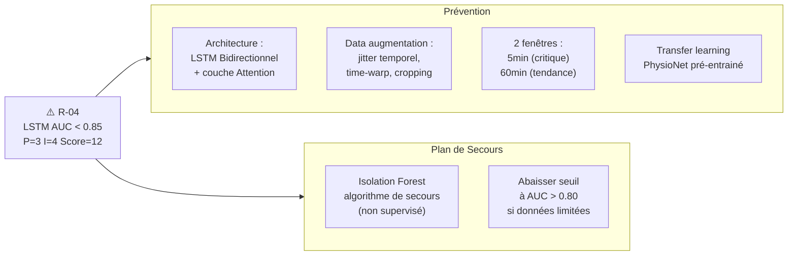

---

#### R-05 — Fuite Données RGPD `🟠 Élevé (Impact=5)`

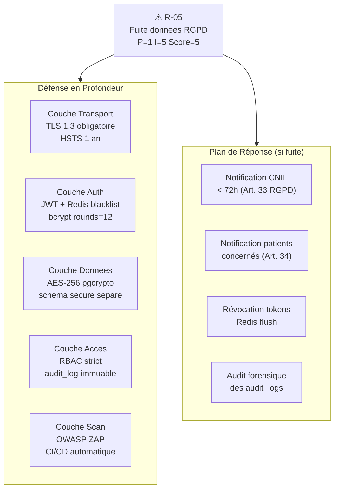

---

#### R-06 — Dérive du Modèle en Production `🟠 Élevé`

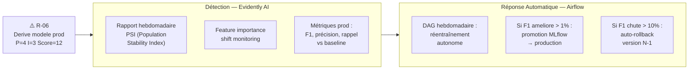

---

### 9.4 Processus de Suivi des Risques

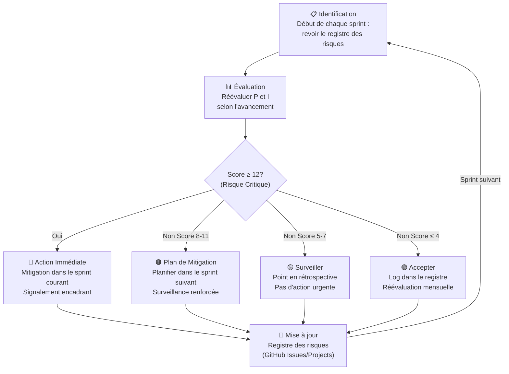

---

## 10. Environnement & Outils de Travail

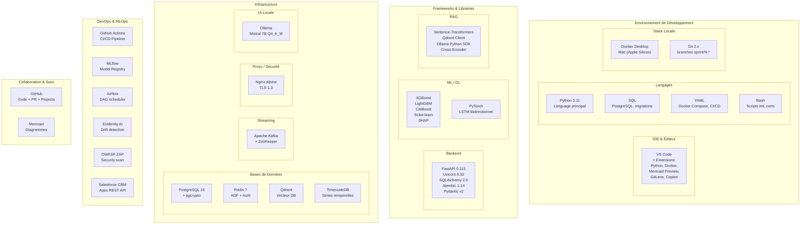

### Matériel

| Composant | Spécification |
|-----------|--------------|
| **Machine** | MacBook Pro (Apple Silicon M-series) |
| **RAM** | 16 GB minimum (Mistral 7B = 4.1 GB + stack Docker) |
| **Stockage** | 50 GB libres (images Docker + modèles Ollama) |
| **OS** | macOS + Docker Desktop |
| **Réseau** | Internet (téléchargement modèles, CDN Swagger en build) |

---

## 11. Processus Git & CI/CD

### Stratégie de Branches

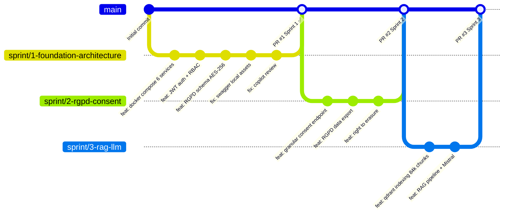

### Règles Git

| Règle | Description |
|-------|-------------|
| **1 branche par sprint** | `sprint/N-nom-sprint` — jamais de commit direct sur `main` |
| **1 PR par sprint** | Merge via Pull Request avec review Copilot AI |
| **Convention commits** | `feat:`, `fix:`, `docs:`, `test:`, `refactor:`, `chore:` |
| **Secrets** | Jamais dans le code — toujours dans `.env` (gitignored) |
| **Tags** | `v1.0.0-sprint1`, `v2.0.0-sprint2`, ... à chaque merge |

### Pipeline CI/CD (Sprint 6)

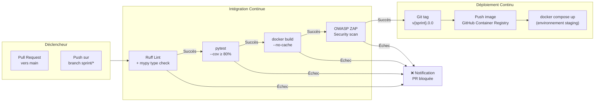

---

## Récapitulatif Méthodologique

```mermaid
flowchart LR
    subgraph WHY["Pourquoi cette méthode ?"]
        A1["8 domaines techniques<br/>hétérogènes"]
        A2["Performances ML<br/>connues après expérim."]
        A3["Feedback encadrant<br/>indispensable"]
        A4["Livraisons<br/>incrémentielles"]
    end

    subgraph HOW["Comment ?"]
        B1["Scrum<br/>2 semaines/sprint"]
        B2["52 User Stories<br/>329 Story Points"]
        B3["Git branch/sprint<br/>+ PR + CI/CD"]
        B4["DoD stricte<br/>pytest ≥ 80%"]
    end

    subgraph WHAT["Résultat attendu"]
        C1["10 sprints livrés<br/>août 2026"]
        C2["Plateforme IA<br/>production-ready"]
        C3["Rapport PFE<br/>complet"]
        C4["Soutenance<br/>EMSI Marrakech"]
    end

    WHY --> HOW --> WHAT
```

---

## 12. Plan d'Implémentation — Objectif 10/10

Cette section transforme la roadmap qualité en **plan d'exécution concret** pour atteindre un niveau jury maximal (stabilité technique + preuves mesurables + démonstration reproductible).

### 12.1 Axes de mise en œuvre

| Axe | Action d'implémentation | Critère de réussite |
|-----|--------------------------|---------------------|
| **1. Branche de référence** | Créer `release/jury`, merger `main` + branche sprint active, geler les merges directs | Une seule branche source de vérité |
| **2. CI unifiée** | Pipeline unique lint + tests + build + smoke ingestion | 100% checks verts sur PR |
| **3. Qualité tests** | Corriger les tests instables, couvrir auth/safety/RAG/MCP/ingestion | Suite stable et reproductible |
| **4. Tuning hybride retriever** | Fusion pondérée Dense/BM25 + grid search alpha/k sur benchmark | MRR/NDCG/Recall@k améliorés et tracés |
| **5. Safety clinique** | Jeu red-team (urgences, dosage, injections prompt) + assertions automatiques | Taux de blocage/sécurité mesuré |
| **6. Performance** | Mesurer p95 retrieval, p95 first-token SSE, p95 réponse finale | SLA documentés et respectés |
| **7. Gouvernance données** | Manifeste corpus (source, licence, date, checksum) + procédure refresh | Traçabilité complète des données |
| **8. Observabilité** | Logs structurés pipeline + métriques + dashboard synthèse | Diagnostic incident en quelques minutes |
| **9. Documentation jury** | Consolidation architecture + choix + limites + résultats avant/après | Dossier défendable en soutenance |
| **10. Démo scriptée** | Scénarios fixes FR/Darija/urgence/prix/fallback | Démo stable sans improvisation |

### 12.2 Ordre d'exécution recommandé

```mermaid
flowchart LR
    A["1) Branche release/jury"] --> B["2) CI unifiée"]
    B --> C["3) Stabilisation tests"]
    C --> D["4) Tuning Dense/BM25"]
    D --> E["5) Safety red-team"]
    E --> F["6) Benchmark performance"]
    F --> G["7) Gouvernance corpus"]
    G --> H["8) Observabilité"]
    H --> I["9) Documentation jury"]
    I --> J["10) Démo finale scriptée"]
```

### 12.3 Livrables attendus (preuves)

| Domaine | Livrable concret |
|---------|------------------|
| Git | Branche `release/jury` propre + historique lisible |
| CI/CD | Workflow GitHub Actions vert sur PR et push |
| Tests | Rapport tests + couverture + scénarios critiques |
| Retrieval | Rapport tuning (alpha/k) avec métriques comparatives |
| Sécurité | Rapport red-team + comportements de blocage validés |
| Performance | Tableau p95 par étape du pipeline |
| Données | `corpus_manifest` versionné (provenance/licence/checksum) |
| Ops | Dashboard métriques + logs structurés exploitables |
| Jury | README/Docs harmonisés avec résultats finals |
| Démo | Script opératoire de soutenance (pas à pas) |

### 12.4 Definition of Done global (objectif 10/10)

Le projet est considéré **10/10 prêt soutenance** si :

1. CI verte en continu sur la branche de référence.
2. Tests critiques stables (aucun échec intermittent).
3. Retriever hybride réglé sur benchmark avec gains mesurés.
4. Safety clinique validée par red-team scénarisé.
5. Performance p95 documentée et conforme aux objectifs.
6. Données traçables (source/licence/date/checksum) et reproductibles.
7. Documentation finale cohérente avec l'état réel du code.
8. Démo scriptée exécutable de bout en bout.
